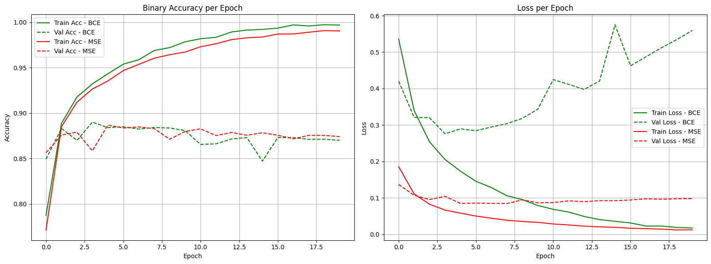
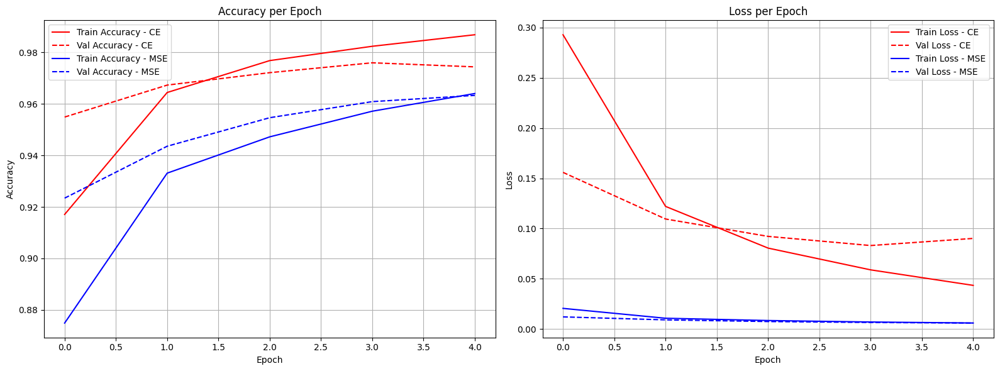
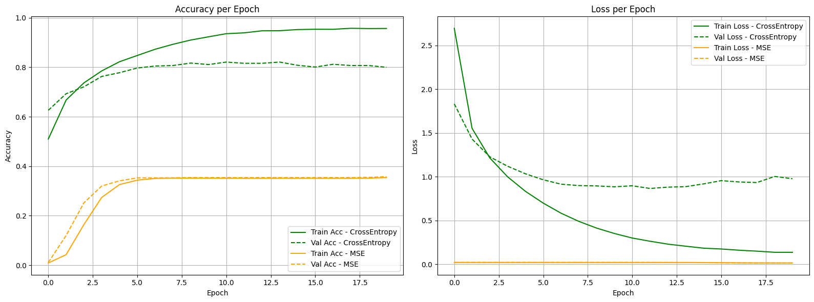

# Dense Neural Network Experiments in Keras: IMDB, MNIST and Reuters

Hands-on experiments with plain fully connected networks on three classic Keras datasets. For each dataset a baseline model is trained, and then one design choice at a time is varied: activation function, loss function, input vocabulary size, depth and width.

> Persian summary / خلاصه فارسی: آزمایش‌های شبکه‌ی عصبی Dense با Keras روی سه دیتاست IMDB، MNIST و Reuters؛ مقایسه‌ی ReLU و Tanh، تابع هزینه‌ی MSE و Cross-Entropy، و اثر تعداد کلمات، لایه‌ها و نورون‌ها.

## Notebooks

| Notebook | Task | Baseline model |
|---|---|---|
| [`01_imdb_sentiment.ipynb`](notebooks/01_imdb_sentiment.ipynb) | Binary sentiment classification (25,000 test reviews) | Multi-hot (10,000 words) → Dense(16) → Dense(16) → sigmoid, 20 epochs, batch 512 |
| [`02_mnist_digits.ipynb`](notebooks/02_mnist_digits.ipynb) | 10-class digit classification (10,000 test images) | Flattened 28×28 → Dense(512, ReLU) → softmax, 5 epochs, batch 128 |
| [`03_reuters_topics.ipynb`](notebooks/03_reuters_topics.ipynb) | 46-class newswire topics (2,246 test samples) | Multi-hot (10,000 words) → Dense(64) → Dense(64) → softmax, 20 epochs, batch 512 |

All models use the RMSprop optimizer. Each notebook has the same sequence of experiments:

1. Baseline model
2. ReLU vs. Tanh activation
3. MSE vs. cross-entropy loss
4. Number of input words (IMDB and Reuters: 1,000 / 5,000 / 10,000 / 15,000)
5. Number of hidden layers (IMDB: 3 / 5 / 7; MNIST: 1 / 3 / 5; Reuters: see note below)
6. Number of neurons (IMDB: 16–256; MNIST: 128–1024; Reuters: 32–256)

## Results

Test accuracies printed by the notebooks (single, unseeded runs; the same configuration varies slightly between cells).

| Experiment | IMDB | MNIST | Reuters |
|---|---|---|---|
| Baseline | 0.8571 | 0.9811 | 0.7836 |
| ReLU | 0.8593 | 0.9745 | 0.7872 |
| Tanh | 0.8553 | 0.9721 | 0.7885 |
| Cross-entropy | 0.8596 | 0.9747 | 0.7841 |
| MSE | 0.8626 | 0.9626 | 0.3709 |

Observations supported by these numbers and plots:

- **ReLU vs. Tanh:** the difference is below half a percentage point on all three datasets, which is within run-to-run variation.
- **MSE vs. cross-entropy:** on IMDB (sigmoid output) the two are similar. On MNIST MSE is about 1 point lower, and on Reuters (46-class softmax) MSE is far worse: in the plot its accuracy stays around 0.35 while cross-entropy reaches about 0.8. Test losses of different loss functions are on different scales and should not be compared.
- The number-of-words, layers and neurons experiments are available as training/validation curves inside the notebooks; no numeric summary was printed for them, so none is claimed here.

### Selected plots





ReLU vs. Tanh plots for each dataset are in [`results/`](results/).

## Notes and limitations

- **Reuters layers experiment:** the models labelled 2 / 5 / 7 hidden layers in the code and plot titles actually have 3 / 6 / 8 hidden layers (one input layer plus the loop count). The code was left as originally run.
- **MNIST validation:** the layers and neurons experiments use the test set as `validation_data`, and the ReLU/Tanh and loss experiments train on 80% of the data (`validation_split=0.2`), unlike the baseline. Treat comparisons across these cells with care.
- **IMDB saved outputs:** two cells show "Overfitting starts at epoch …" lines from an earlier version of the code (now commented out). They are not results of the current code.
- Single runs without a fixed random seed; no repeated trials or confidence intervals.
- Bag-of-words (multi-hot) input ignores word order.

## Getting started

```bash
git clone <repository-url>
cd keras-dense-network-experiments
python -m venv .venv
.venv\Scripts\activate        # Windows (macOS/Linux: source .venv/bin/activate)
pip install -r requirements.txt
jupyter notebook
```

Open a notebook from `notebooks/` and run all cells. The datasets are downloaded automatically by Keras on first use (internet connection required).

## Technologies

Python 3.11 (from notebook metadata), Keras / TensorFlow, NumPy, Matplotlib, Jupyter

## Academic note

Individual university coursework (deep learning).
